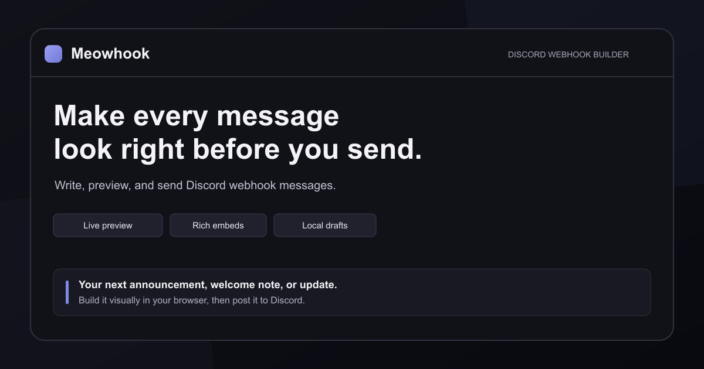

# Meowhook

[Live application](https://www.meowhook.com/) · [Architecture and bot protocol](docs/BOT_PROTOCOL.md) · [Contributing](CONTRIBUTING.md) · [Apache 2.0](LICENSE)



**A full-stack TypeScript application for building Discord messages visually.**

Meowhook brings a live message preview, rich embeds, Components V2, reusable drafts, and JSON editing into one workspace. The source also includes an optional authenticated dashboard for bot messages, forms, commands, and scheduling.

## Project tour

| Area | What to explore |
| --- | --- |
| Message editor | Reorderable layout blocks, media, text formatting, and Discord previews |
| State and persistence | Zustand state, browser draft storage, IndexedDB uploads, and cross-tab write coordination |
| Server features | OAuth sessions, database-backed workspaces, signed Discord interactions, and scheduled jobs |
| Quality checks | Vitest regression tests, Playwright flows, TypeScript checks, and CI |

**Stack:** Next.js, React, TypeScript, Tailwind CSS, Zustand, PostgreSQL / SQLite, Better Auth, Vitest, and Playwright.

The anonymous editor works without account services. Dashboard features require the environment configuration below; the public demo and a self-hosted installation may have different optional services enabled.

## Source map

| Path | Responsibility |
| --- | --- |
| `src/components/editor/` | Visual message editing |
| `src/stores/` | Application state |
| `src/lib/` | Payloads, persistence, authentication, and domain logic |
| `src/app/api/` | Server route handlers and integrations |
| `src/components/dashboard/` | Account workspace UI |
| `e2e/` | Browser-level checks |
| `scripts/` | Build verification and public-source release gates |

## Development and self-hosting

A Discord message workspace with a browser-based webhook editor and an account dashboard for bot messages, interactive components, forms, commands, and scheduling.

Licensed under [Apache 2.0](LICENSE). See [NOTICE](NOTICE) and [contribution guidance](CONTRIBUTING.md).

## Run locally

```sh
npm ci
npm run dev
```

Open the localhost URL printed in the terminal. The development and production scripts use Webpack because this project's Google font imports currently fail with Turbopack in the local Windows environment.

Use Node.js 22.16 or newer; Node.js 24 LTS is used in CI. The local account database uses Node's built-in SQLite driver.

```sh
npm run lint
npm test
npm run build
npm start
```

The build command also runs the unit tests and checks deployment traces to prevent packaging local account databases, uploaded files, or environment files. `npm run verify:package` can repeat that packaging check after a build.

## Optional services

The editor and webhook sending work without server environment variables. Copy `.env.example` to `.env.local` to configure feedback delivery and expiring Cloudflare KV share links. Without KV, sharing falls back to a link containing the message data. Do not commit credentials.

Analytics and Adobe Fonts are optional and disabled unless you configure your own
`NEXT_PUBLIC_UMAMI_WEBSITE_ID` or `NEXT_PUBLIC_ADOBE_FONTS_KIT_ID`. These are public
integration IDs; never put service secrets in a `NEXT_PUBLIC_*` variable.

Drafts, saved webhooks, and templates live in browser storage. Uploaded files are kept in IndexedDB in the same browser and restored after reload. JSON exports and local backups keep file references; JSON does not bundle file bytes for moving to another device. Share links exclude webhook URLs and local uploads.

Sending from the standalone editor uses a webhook URL directly from the browser. Regular messages can include URL buttons. Components mode supports ordered text, thumbnail sections, media galleries, files, separators, containers, and URL buttons through Discord's `with_components=true` webhook option. Components mode uses Discord's `IS_COMPONENTS_V2` flag, so regular content and embeds are kept in the draft but excluded from that message's send payload.

## Account dashboard and Discord bot

Open `/login` to continue with Discord and `/dashboard` for your saved workspace. Discord provides the account identity; Meowhook does not have a separate username/password sign-up. Better Auth manages the OAuth flow and server sessions. Local development stores sessions and workspace records in a private SQLite database and creates a persistent authentication secret under ignored `.data/`. Anonymous browser drafts remain independent of account records. `Save to account` copies the current editor message into the dashboard. `Open in full editor` adds a local copy while preserving existing drafts.

The dashboard includes:

- Standard embeds and the complete Components V2 editor, JSON editing, uploads, and Discord previews.
- Buttons in Discord’s four interactive styles, custom emoji, private replies, self-role buttons, static role dropdowns, and native role pickers with an explicit role allowlist.
- Forms with text, dropdowns, user/role/channel/mentionable pickers, file uploads, radio buttons, checkboxes, and response storage in the owner’s dashboard.
- Slash commands, user context commands, and message context commands, with guild-wide publishing that preserves other administrators’ commands.
- Once, daily, and weekly schedules in named timezones, with DST handling, pause/cancel, persistent job claims, bounded retries, and protection against duplicate sends after an uncertain response.
- Server access checked against the signed-in Discord user’s Manage Server permission, with bot role hierarchy and channel overwrite checks before delivery or role assignment.

After signing in with Discord, you can build and save before the bot is installed. Discord sign-in requires the OAuth application configuration in `.env.example`, including during local development. When it is unconfigured, the login screen reports that state and the anonymous webhook editor remains available. Bot publishing and actual message delivery additionally require the bot configuration. The interface does not simulate a Discord connection or create a local substitute account.

Production accounts require `DATABASE_URL` (PostgreSQL), `BETTER_AUTH_SECRET` (at least 32 random characters), and `BETTER_AUTH_URL`. Authentication and application tables are migrated under a PostgreSQL advisory lock. Vercel never stores accounts, schedules, or uploads on its ephemeral filesystem. Production uploads use Vercel Blob direct uploads; local uploads use ignored `.data/media/`. Uploaded files have opaque public URLs so Discord can fetch them; avoid uploading private material.

The bot uses Discord HTTP interactions, not a background gateway daemon. The interaction URL is `/api/discord/interactions/<DISCORD_APPLICATION_ID>`. Only valid signed Discord requests can invoke actions. The schedule worker is `/api/cron/schedules`, protected by `CRON_SECRET`; `vercel.json` requests a one-minute cron, which requires a hosting plan supporting that cadence. No browser timer is used. Disabling or deleting an action stops subsequent dispatches that reference it. Network timeouts after a send become visibly uncertain and are never automatically replayed.

See [bot protocol](docs/BOT_PROTOCOL.md) for runtime behavior and integration requirements.

## Publishing

For an open-source release, run `npm run release:check` and `npm run release:export`.
The export contains the current source, license, tests, and example configuration,
without Git history or private local files. Initialize a new Git repository in that
export when publishing a fresh source release. The original checkout's ignore rules
do not remove files or credentials from older commits; audit history separately
before changing an existing repository's visibility.

Local edits do not change a deployed site. Configure your own hosting project and server environment variables, review and push changes to the intended branch, then verify the deployment before promoting it to production. Set the production branch in your hosting provider explicitly.

Draft writes are serialized across browser tabs using Web Locks. A stale tab stops saving and offers a download of its edits or a confirmed reload of the saved version. Save errors remain visible until resolved. The latest send results are retained per draft in browser storage; Retry unsent excludes successful messages.

## Search visibility after publishing

The site uses `https://www.meowhook.com/` as its canonical domain. Keep the apex-domain redirect to `www` in Vercel, and check that the live `/robots.txt`, `/sitemap.xml`, `/about`, and `/meowhook-social.png` URLs work after deployment. The sitemap lists the public pages without claiming a fresh modification date on every build.

Verify the domain in [Google Search Console](https://search.google.com/search-console) with DNS, or set `GOOGLE_SITE_VERIFICATION` in the Vercel production environment to use Google's HTML-tag method. Then submit `https://www.meowhook.com/sitemap.xml` and inspect the homepage, About, and Docs URLs. Use the Search Console Performance and Page indexing reports to see which searches find the site and whether Google can index its pages. Search rankings and indexing are determined by Google; metadata and a sitemap do not guarantee a top position.
